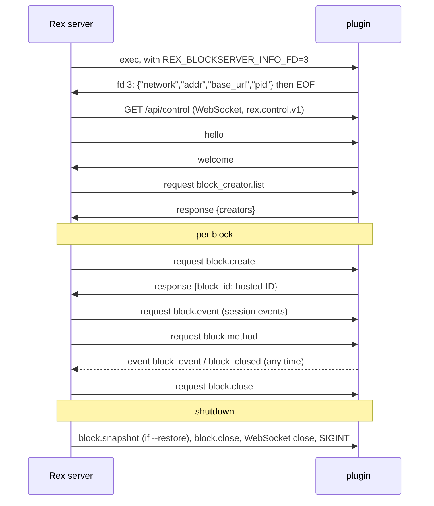

# Rex block plugin protocol (observed)

Reverse-engineered from Rex `0.1.0-preview.21` (server build 2061, `api_revision` 18), with a logging probe plugin and a WebSocket proxy between the `rex` CLI and a dev server. Rex does not document this protocol. It can change in any release.

Labels:

- **Verified**: seen on the wire or in server logs, or tested with a change that made the server accept or reject something.
- **Inferred**: read from strings in the binary, or a guess. Not tested.

## Summary



The plugin is a WebSocket **server**. Rex is the client. The channel uses the same `rex.control.v1` framing that the `rex` CLI uses to talk to the Rex server.

## 1. Discovery and startup

| Fact | Status |
|---|---|
| `rex server run --block-dir DIR` runs every executable file in `DIR` with no arguments (`arg_count=0` in the log). | Verified |
| No other plugin dir was scanned on this machine. The binary has `blockplugin.DefaultDirs` and the string `rex/blocks`, so a default dir probably exists (likely `<UserConfigDir>/rex/blocks`). Neither `~/Library/Application Support/rex/blocks` nor `~/.config/rex/blocks` exists here. | Inferred |
| Plugins start before the server says `Rex server ready`. The server waits for the plugin. No startup timeout fired within 30 s. | Verified |
| A plugin that fails is skipped (`WARN skipping discovered block plugin that failed to start`), sent SIGINT, and the server starts without it. | Verified |
| The child gets the server's environment plus `REX_BLOCKSERVER_INFO_FD=3`. The server does not remove `REX_SERVER`, `REX_SESSION` or `REX_BLOCK` that it inherited. | Verified |
| cwd is the server's cwd. stdin, stdout and stderr are `/dev/null`: plugin output is lost. | Verified |
| If the plugin dies, the server does not restart it. Its blocks stay listed. Calls to them fail with `blockremote: remote control disconnected (status=500 code=internal)`. | Verified |
| `--block-plugin-reload` watches sources and restarts plugins (`reload`, `goRunReloadPaths` in the binary). | Inferred, not tested |

## 2. Connection info (fd 3)

Write one JSON object to the fd named by `REX_BLOCKSERVER_INFO_FD`, then close it.

```json
{"network":"unix","addr":"/tmp/rexplugin-123/control.sock","base_url":"http://rexplugin","pid":4242}
```

| Field | Rule | Status |
|---|---|---|
| `network` | Required. `unix` works. Empty gives `unsupported connection network ""`. `tcp` passed validation (then the dial failed because `addr` was a path). | Verified |
| `addr` | Required. The key is `addr`, not `address`: `address` gives `connection info address is empty`. | Verified |
| `base_url` | Required, any non-empty URL. It sets the HTTP `Host`. | Verified |
| `pid` | Optional (logged as `pid=0` when absent). A wrong pid (`1`) was accepted. The error string `connection info pid = %d, want child pid %d` exists, but this code path did not use it. | Verified |
| `sdk_version`, `features` | Optional. Logged as `sdk_version=x features=[a]`. | Verified (no visible effect) |
| The process exits or closes fd 3 with no info | `process exited before reporting connection info`. | Verified |

## 3. Control channel

Rex dials `addr` and sends:

```
GET /api/control HTTP/1.1
Upgrade: websocket
Sec-WebSocket-Protocol: rex.control.v1
Sec-WebSocket-Extensions: permessage-deflate; client_no_context_takeover; server_no_context_takeover
```

- Any other answer gives `connecting to API control: server returned 404 Not Found`. **Verified**
- The plugin can decline the deflate extension. Then all frames are uncompressed text frames. **Verified**
- Rex opens one control connection for each plugin process. **Verified**

All messages are JSON text frames.

### Handshake

```json
← {"type":"hello","api_revision":18}
→ {"type":"welcome","protocol":"rex.control.v1","limits":{"max_message_bytes":1048576}}
```

Rex rejects a welcome that has no `protocol` or a zero `limits.max_message_bytes` (`invalid API control welcome: apitypes.ControlWelcome{...}`). Those 3 fields are enough. **Verified.** The welcome struct also has `carriers`, `client`, `features`, `api_revision`, `api_server_revision` and `api_min_revision`. Their meaning is **inferred** from the Rex server's own welcome: `{"client":{"id":"client:…","reconnect_token":"…"},"api_revision":18,"api_server_revision":18}`.

### Requests and responses

```json
← {"type":"request","id":"control-2","method":"block.create","payload":{...}}
→ {"type":"response","id":"control-2","seq":0,"payload":{...}}
→ {"type":"response","id":"control-2","seq":0,"error":{"code":"bad_request","message":"…","status":400}}
```

- `payload` is left out when there is no input or output. A response with no `payload` and no `error` is a success. **Verified**
- Error codes seen from the Rex server: `method_not_found`/404, `bad_request`/400, `internal`/500. Rex shows a plugin error to the caller wrapped as `… (status=400 code=bad_request) (status=500 code=internal)`. **Verified**
- `seq` is always 0 in single responses. The `stream response` wording in errors suggests multi-part responses with increasing `seq`. **Inferred**
- Request ids are `control-N`, one counter per connection. The plugin answers requests concurrently and out of order. Rex accepted this (16 parallel `ticket` calls, all answered). **Verified**

### Events (plugin → Rex)

The plugin can push events at any time, in the same frame shape as the events the Rex server sends to its clients:

```json
→ {"type":"event","payload":{"type":"block_event","payload":{"block_id":"<hosted id>","name":"producer_exited","payload":{"pid":80455,"status":"signal: killed"}}}}
→ {"type":"event","payload":{"type":"block_closed","payload":{"block_id":"<hosted id>"}}}
```

| Event | Effect | Status |
|---|---|---|
| `block_event` | Session subscribers get `session_event` → `block_event` `{block_id: <session id>, creator_name, name, payload}`. `rex events -s SESSION --json` shows it. Rex also echoes it back to every block in the session with `block.event`. | Verified |
| `block_event` validation | None. An undeclared `name` and a payload that breaks the event schema both went through. | Verified |
| Wrong inner keys (`event: {type, payload}`) | Delivered with `name: ""`. No error. | Verified |
| `block_closed` | Rex removes the block (`block_closed`, then `window_closed` if the window is now empty). It does not then send `block.close`. | Verified |
| A third envelope type for actions (`"The hosted block that produced the action."`, with `action`) | Probably `block_action`. | Inferred, not tested |
| `seq` on plugin events | Not needed. | Verified |

## 4. Methods Rex calls

### `block_creator.list`

Sent once after the welcome. `rex block types` shows the result. `host_id` is added by Rex.

```json
→ {"creators":[{"name":"dev.libbowser","title":"Bowser","description":"…",
    "flavors":[{"name":"browser","flavor":"dev.libbowser.browser","title":"Browser","description":"…",
                "options_schema":{"type":"object","properties":{"url":{"type":"string"}},"additionalProperties":false}}],
    "api":{"methods":{"ticket":{"description":"…","input_schema":{…},"output_schema":{…}}},
           "events":{"producer_exited":{…JSON Schema…}}}}]}
```

- An error answer makes the server skip the plugin. **Verified**
- `rex block call` takes the method name without a prefix (`ticket`). `dev.libbowser.ticket` fails with `has no method`. Rex checks method names against `api.methods`. **Verified**

### `block.create`

```json
← {"flavor":"dev.libbowser.browser","options":{"url":"https://example.com"},
   "session_id":"session:01a2…","block_id":"block:01a2…"}
→ {"block_id":"block:0779a172-243a-46c2-8fb1-5e65c79746fa"}
```

- `options` is left out when the caller gives none. **Verified**
- **Rex does not check `options` against `options_schema`**: an enum violation and an unknown key both reached the plugin. The plugin must check them. **Verified**
- The returned `block_id` is the plugin's own **hosted block ID**. Rex uses it in every later call for this block. A random UUIDv4 in `block:` form is accepted. The binary describes `session_id` and `block_id` as optional ("Send it with session_id, or leave both out"). **Verified** (ID) / **Inferred** (optional)
- An error fails the caller's request (for example `session.create` makes no session). **Verified**
- Triggered by `session.create` with `initial_windows`, `session.new_window`, and `session.new_split` with `layout.block.flavor`. The CLI has no flavor flag, so use `rex api call`. **Verified**

### `block.event`

Session events for the block. Answer with an empty success. An error is logged and ignored.

```json
← {"block_id":"<hosted>","event":{"type":"session_attached","payload":{"session_id":"…","block_id":"<session id>"}}}
```

Types seen: `session_attached`, `focus` (`{"action":"in"}`), `session_view_changed`, `client_connected`/`client_disconnected` (`{"client_id"}`, around every CLI call), `block_event` (echo of events from any block). **Verified**

### `block.method`

```json
← {"block_id":"<hosted>","method":"ticket","args":{}}
→ {"ticket":"bowser2:…"}
```

`args` is `{}` when the caller gives none. **Rex does not check `args` against `input_schema`** (`{"x":1}` reached the plugin). **Verified.** It is not known whether Rex checks the output against `output_schema`.

### `block.close`

```json
← {"block_id":"<hosted>"}
→ (empty success)
```

Sent by `rex block close`, `session.destroy`, closing the window, and server shutdown. **Verified**

### `block.snapshot` and `block.restore`

Sent only when the server runs with `--restore` (the default). With `--restore=false`, neither is sent. **Verified**

```json
← block.snapshot {"block_id":"<hosted>","dir":"/var/folders/…/rex-block-snapshot-1836429212"}
← block.restore  {"flavor":"…","options":{…},"session_id":"…","block_id":"<session id>","dir":"/var/folders/…/rex-block-restore-66548042"}
```

- Snapshot runs at shutdown, before `block.close`. The plugin probably writes state files into `dir`, and Rex stores them under `<state-dir>/servers/<hash>/snapshot/blocks/<block uuid>/<gen>/`. **Inferred**
- **If `block.restore` answers `method_not_found`, Rex calls `block.create` with the saved flavor and options and the same session block ID.** The block comes back, with a new hosted ID. A `method_not_found` from `block.snapshot` is harmless. **Verified.** `RestoreOutput` probably holds the restored hosted `block_id`. **Inferred**

## 5. Shutdown

On SIGTERM, the server sends `block.snapshot` (with `--restore` only), then `block.close` for each block, then closes the WebSocket, then sends SIGINT to the plugin. **Verified.** The string `process did not exit within %s` suggests a SIGKILL after a timeout. **Inferred**

When the server is SIGKILLed, the plugin is reparented and gets nothing. Our plugin polls `getppid()` and cleans up. **Verified**

## 6. Calling the server from a plugin

A plugin can call the server's API like the CLI does. Our plugin uses it to set block labels. **Verified** against server build 2061:

1. Find the socket. The server writes `$HOME/Library/Application Support/rex/servers/<hash>/runtime.json`, `{"endpoint":"unix:///…/s.sock","pid":…,…}`. Pick the one whose `pid` is our parent's. Don't trust `REX_SERVER`: see section 7.
2. Connect and check the socket's peer pid (`LOCAL_PEERPID`) is our parent's.
3. `GET /api/control` with `Sec-WebSocket-Protocol: rex.control.v1`. The client masks its frames, per RFC 6455.
4. Send `{"type":"hello","api_revision":18}`. The server answers `welcome`.
5. Call `session.attach {"session_id"}` first. Without it, `session.set_block_label` fails with `stream is not attached to session …` (`bad_request`).
6. `session.set_block_label {"session_id","block_id","label"}`. `block_id` is the **session** block ID from `block.create`, not the hosted one. Labels are trimmed, and at most 128 characters with no control characters.

An attached connection receives the session's events. A plugin that doesn't read them should close the connection after each call, as the CLI does; each connection shows up as `client_connected`/`client_disconnected` in the session.

## 7. Isolation pitfalls

- `--state-dir` does not cover everything. A dev server made `~/Library/Application Support/rex/servers/<hash of the socket path>/` (with `runtime.json` and `start.lock`) in the real Rex state. Run dev servers with a fake `HOME`. **Verified**
- A shell inside a Rex terminal has `REX_SERVER`, `REX_SESSION` and `REX_BLOCK` for the real server. Plugins inherit them, and the `rex` CLI uses `REX_BLOCK` as its default target. Unset them. **Verified**
